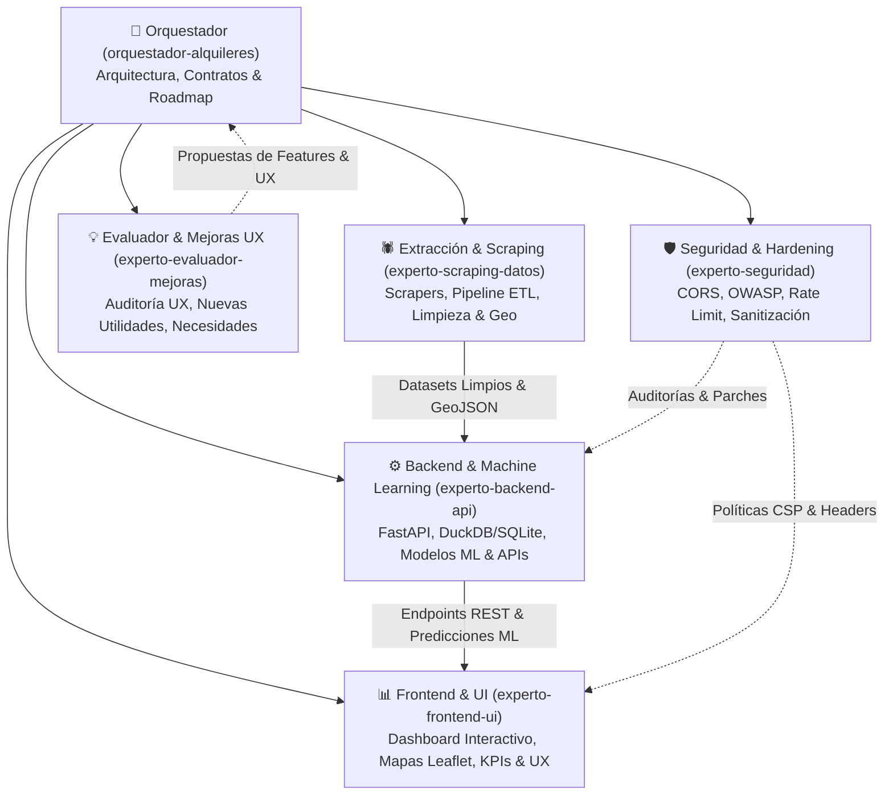

# 🏠 AlquileresCoru — Análisis Predictivo y Mercado de Alquiler en A Coruña
> **Proyecto de Portfolio en Ciencia de Datos, Machine Learning y Visualización Geoespacial**

---

## 🎯 Objetivo del Proyecto
Analizar en profundidad el mercado de alquiler residencial en la ciudad de **A Coruña** (y su área metropolitana), extrayendo **datos reales** del mercado actual mediante web scraping, procesándolos mediante pipelines de Ciencia de Datos, entrenando modelos de Machine Learning para valoración y detección de **oportunidades/chollos**, y exponiendo los resultados en un dashboard interactivo con mapas geoespaciales.

---

## 🤖 Arquitectura Multi-Agente

El proyecto se desarrolla y mantiene coordinado a través de una red de agentes especializados:



### 1. `orquestador-alquileres`
- Define la hoja de ruta técnica, contratos de datos (JSON schemas, Pydantic) y coordina a los subagentes.
- Valida la integridad end-to-end y la rigurosidad estadística.

### 2. `experto-scraping-datos`
- Scrapers resilientes (BeautifulSoup, httpx) para portales inmobiliarios (pisos.com, fotocasa) y generadores sintéticos calibrados.
- Pipeline ETL: normalización de precios, m², habitaciones, geocodificación lat/lon en los distritos de A Coruña y área metropolitana.

### 3. `experto-backend-api`
- Backend en **FastAPI** con almacenamiento eficiente (**Parquet / DuckDB**).
- Endpoints analíticos (precio medio, métricas por m², dispersión por barrio).
- Modelos predictivos (**GradientBoostingRegressor**, $R^2 = 0.938$): tasación estimada y detector de desvíos (chollos vs sobreprecio).

### 4. `experto-frontend-ui`
- Dashboard web interactivo con **Tailwind CSS**.
- Mapa interactivo **Leaflet** con marcadores clasificados por color (Chollo verde, Precio azul, Sobreprecio rojo) y popups con fotos y enlaces directos al anuncio original.
- Calculadora/Simulador interactivo de tasación de alquiler.
- KPIs ejecutivos y gráficos interactivos de mercado.

### 5. `experto-seguridad`
- Hardening de FastAPI: CORS restrictivo, rate limiting y prevención de abuso de endpoints.
- Sanitización estricta de filtros de búsqueda y parámetros de entrada.
- Seguridad en dependencias y headers HTTP.

### 6. `experto-evaluador-mejoras`
- Auditorías de usabilidad (UX) y valor de negocio para inquilinos, propietarios y reclutadores.
- Identificación de nuevas utilidades y priorización por impacto/esfuerzo.

---

## 📁 Estructura del Proyecto

```
alquileresCoru/
├── data/
│   ├── raw/             # Datos brutos extraídos
│   ├── processed/       # Datasets reales y enriquecidos (parquet/csv)
│   └── synthetic/       # Datos calibrados para benchmarking
├── scraper/             # Módulos de extracción y limpieza de datos (Pisos.com, Fotocasa)
├── backend/             # API FastAPI, esquemas Pydantic y modelos ML
├── frontend/            # Interfaz web interactiva, mapa Leaflet y simulador
├── analysis/            # Scripts analíticos de oportunidades y métricas
├── config/              # Parámetros de configuración y barrios de A Coruña
└── README.md
```

---

## 🚀 Puesta en Marcha

### 1. Requisitos
- Python 3.10+
- Dependencias: `pip install -r backend/requirements.txt`

### 2. Ejecutar la Aplicación
```bash
uvicorn backend.main:app --host 127.0.0.1 --port 8000 --reload
```
Abre en tu navegador:
- 🌐 **Dashboard & Mapa Interactivo**: [http://127.0.0.1:8000](http://127.0.0.1:8000)
- 📖 **Documentación Swagger OpenAPI**: [http://127.0.0.1:8000/docs](http://127.0.0.1:8000/docs)
